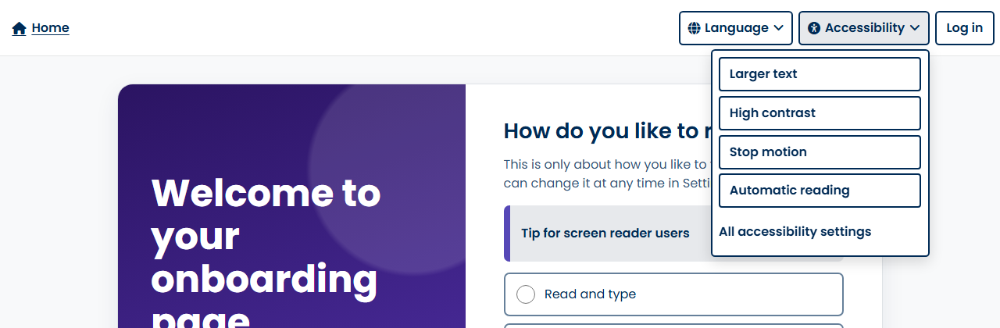
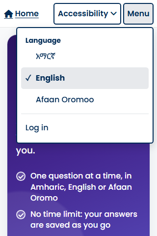

# Savanna Accessible Onboarding Module

A reusable onboarding and learner-profile **module** for the Savanna learning platform, built for the Digital Bridge
Accessibility Hackathon 2026 (ALX Ethiopia), Track 1. It is not a website or an LMS: it is a web component that Savanna
or any other site adds with **two script tags**. No framework, no build step, no server, no paid service.

**Live demo:** https://savanna-accessible-onboarding.vercel.app

| Page | What it is |
|---|---|
| [`/`](https://savanna-accessible-onboarding.vercel.app/) | **The learner journey inside Savanna's own pages** (ALX starter kit): home → sign up → dashboard → profile and Support Passport → jobs and apply → employer form. Log-in is simulated |
| [`/test-host/`](https://savanna-accessible-onboarding.vercel.app/test-host/) | **Test host page**: an ordinary page (not Savanna) that uses only the public API, and shows exactly what the host receives |
| [`/showroom.html`](https://savanna-accessible-onboarding.vercel.app/showroom.html) | Developer and test page (all journeys behind one menu) |

**Access without disclosure:** learners choose how they want to interact (read-aloud, voice, larger text, simple
mode) without ever stating or proving a disability. **Nothing leaves the host without consent:** the module itself
sends nothing over the network.

---

## Install it in under an hour

You need: a terminal, and either **Docker** or **Node.js 18+** (or Python 3). Times are rough guides.

### Step 1 — Run the demo locally (5 minutes)

```bash
git clone https://github.com/zeamanuelmek/savanna-accessible-onboarding.git   # or unzip the submitted copy
cd savanna-accessible-onboarding
docker compose up
```

Open http://localhost:8080 (the Savanna journey), http://localhost:8080/test-host/ and
http://localhost:8080/showroom.html. Stop with `Ctrl+C`. Another port: `PORT=9000 docker compose up`.

**Without Docker:** any static file server works, because these are plain files.

```bash
cd savanna-accessible-onboarding/savanna-onboarding
npx --yes serve -l 8080 .          # or: python -m http.server 8080
```

### Step 2 — Add the module to your own page (15 minutes)

1. Copy these from `savanna-onboarding/` to your site, **keeping them side by side**:
   `savanna-onboarding.js`, `forms.js`, and the folder `assets/fonts/`. (The script finds the fonts next to itself.)
2. Add two script tags and an empty element where the form should appear:

```html
<script src="/path/to/savanna-onboarding.js" defer></script>
<script src="/path/to/forms.js" defer></script>

<div id="onboarding"></div>

<script>
  document.addEventListener('DOMContentLoaded', function () {
    var handle = SavannaOnboarding.mount('#onboarding', {
      form: 'signup',          // signup | passport | profile | takeover | apply | employer
      welcome: true,           // start with "how would you like to answer?"
      headingLevel: 2,         // your page already has an <h1>: the question becomes an <h2>
      onComplete: function (detail, doneSlot) {
        // detail = { form, instance, lang, answers }  (exact JSON Schema: docs/api-schema.md)
        // Send it to YOUR server here, if the learner agreed. The module sends nothing itself.
        doneSlot.innerHTML = '<p><a href="/dashboard">Go to my dashboard</a></p>';
      }
    });
    // later: handle.unmount();   or   SavannaOnboarding.unmount('#onboarding');
  });
</script>
```

3. Open your page. You should see the first question, in the learner's language (Amharic by default).

Prefer plain HTML? `<savanna-onboarding-form form="signup" welcome></savanna-onboarding-form>` works too, and the
same data arrives in the `savanna-onboarding:complete` event (it bubbles to `document`).

### Step 3 — Save the data where you want it (15 minutes)

- **What you receive:** [`docs/api-schema.md`](docs/api-schema.md) has a JSON Schema for every form, plus the
  schema.org `JobPosting` mapping for jobs (integration Level 3). There is **no REST API and no endpoint** to call.
- **Support needs go to an employer only with consent for that application.** Use
  `SavannaOnboarding.supportForEmployer(detail.answers)`: it returns `[]` unless the learner said "share" for that job.
- **Device storage:** drafts and settings are kept in the browser under keys starting `savanna-onboarding.`. To keep
  them elsewhere, plug in your own storage:
  `SavannaOnboarding.setStorage({ getItem, setItem, removeItem, keys })`.
- **Speech engine:** voice input and read-aloud go through one adapter, `SavannaOnboarding.setSpeech({ input, output })`
  (see [`docs/for-developers.md`](docs/for-developers.md)). The default is the browser's own (free) engine.

### Step 4 — Make it look like your site (10 minutes)

All styles are scoped (classes start `dm-`) and every colour, font and size is a CSS custom property starting `--so-`.
Override any of them, for example `:root { --so-primary: #0b6e4f; }`. Values and contrast results:
[`../DESIGN_TOKENS.md`](../DESIGN_TOKENS.md). Learners' own settings (text size, high contrast) keep working.

### Step 5 — Check it (10 minutes)

- Open `/test-host/`: choose a journey, **Mount**, answer it, and read "Events the host received". **Unmount** removes it.
- Keyboard only: `Tab` through a whole sign-up. Then try 200% zoom, and a screen reader if you have one.
- Run the automated tests (optional): see [Tests](#tests).

**If something goes wrong:** no form appears → check the browser console for
`[savanna-onboarding] mount: no element matches …` (wrong selector) or a 404 on the script path. Squares instead of
Amharic letters → the `assets/fonts/` folder is not next to `savanna-onboarding.js`. Voice button missing → that
browser has no speech engine (typing and tapping always work).

### Inside Savanna

The demo's home page shows the module inside Savanna's own pages. Savanna's stylesheets are copied **unchanged** from
the official starter (`vendor/savanna-static-pages/`, see its `VENDOR.md`); our pages add Savanna's header and sidebar
around the module. In our copy of that frame we fixed four accessibility problems we found in the starter, and we
recommend the same fixes to ALX:

| In the starter | In our pages |
|---|---|
| The menu ("hamburger") is a `<div>`, so the keyboard and screen readers cannot use it | A real `<button>` with a visible "Menu" label and `aria-expanded` |
| The logo link has no text | No logo (the module is for any organisation); visitors who are not logged in get a plain "Home" link |
| The sidebar is not a navigation landmark, and the list contains `<hr>` elements | A `<nav aria-label="Savanna">` with a clean list; the current page has `aria-current="page"` |
| Sidebar text and icons are grey `#98a3ae` (2.6:1, below the 4.5:1 minimum) | Navy text and icons |

Also added: a "Skip to main content" link, and focused items never hide under the header.

**Home page.** It follows the layout of ALX's own sign-up page: a welcome panel on the left, and on the right first
"How would you like to use Savanna?" (read and type, listen, speak, simple steps with pictures), then "Sign up or log
in". The choice is saved as the learner's preference, so the sign-up form starts straight at its first question.

**Dashboard = ALX's self-paced learner homepage.** After onboarding, the learner lands on `dashboard.html`, built by
`tools/dashboard-page.cjs` from the starter's `pages/homepage-v1-self-paced.html` (vendored unchanged): curriculum
bar and course switcher, greeting, Course Progression, My activities, My Pacing Boost, My upcoming events and the
"Program details" dialog, word for word. Our copy changes only what the generator lists: the learner's own name and
greeting; the course switcher is a real `<button>`; its menu is not a broken list; the progress bar has a name; the
pacing tooltip opens on keyboard focus; the greeting is the `<h1>` and headings are in order; ALX's red `#db3e3e`
(4.4:1) becomes `#da3a3a` (4.52:1); long titles wrap instead of being cut off with "…"; the curriculum bar sits in
the page flow. `journey/dashboard.js` replaces ALX's `static-page.js` (module tabs say which is chosen).

**Where our menu went (signed in).** Savanna's sidebar has ALX's items in ALX's order: Home · Access my learning ·
*My resources* (My courses, Conference rooms, Servers, Sandboxes, Video on demand) · *My Campus* (Peers, **Jobs**) ·
My Profile at the bottom. Our links are in standard places: **Jobs** in "My Campus" (a campus resource for
learners); **My profile** is ALX's "My Profile"; **Support Passport, My profile, Accessibility settings, Log out** in
the account menu at the top right (a disclosure button with plain links); **All accessibility settings** also in
the header's Accessibility panel on every page; **For employers: post a job** in the footer (employers are
not learners). "My dashboard" became ALX's "Home". Savanna sections that are not in the demo (My courses, Servers…)
say so when chosen. The ID status, Support Passport status and "Delete my data from this phone" cards moved from the
old dashboard to **My profile**. Pages for visitors who are not logged in (home, sign-up, log-in) have no sidebar,
as on ALX's own sign-up page; "Log in" or "Sign up" is at the top right.

**One header bar** on every page (after the skip link, which comes first): **Home** on the left; on the right
**Language ▾** (a disclosure button and a short list, each language named in its own script), **Accessibility ▾** and
**Log in** (or the account menu when logged in). On small screens and at 200% or 400% zoom it is **Home,
Accessibility ▾ and Menu**, with the Savanna sections (when logged in), the language and Log in or the account links
inside Menu. It is never two rows. The header stays at the top (sticky, 72px; 56px on phones).




**Accessibility ▾** opens a disclosure panel (a button with `aria-expanded`, not a modal), the landmark named
"Accessibility options": **Larger text, High contrast, Stop motion and Automatic reading**, each an on/off toggle
with `aria-pressed` (the pressed state also shows a tick and a dark fill, not colour alone), and a link to **All
accessibility settings**. Escape closes it and returns focus to the button; a click elsewhere closes it. **The
language is set only in the header** (and in Settings): the forms have no language choice of their own. On the
developer page the language button is in the page header. The choices are the module's own saved preferences, so
they follow the learner to every page and form.

**One switch for reading.** "Automatic reading" (the Accessibility panel, or Settings) covers both the page
summaries and the questions; the forms have no "Read aloud" switch of their own. Inside a form, "Listen to the
question" and "Get help" stay in the same place on every step. **Playback controls appear only while audio plays:**
a small bar pinned to the bottom of the page, "Now reading… Pause · Stop", announced politely (`role="status"`) and
hidden when nothing plays. Escape stops the sound. While the bar shows, the page gets bottom padding and scroll
padding of the bar's height, so it never covers the focused control (WCAG 2.4.11). The bar is drawn by the module,
so it also works on other host pages.

**Accessibility settings** has every choice of the panel and more (how I like to answer, pictures, voice consent), with a
live preview, "← Back to …" at the top and "Done: back to …" at the bottom: both return to the page the learner came
from in this tab (never to Log in, so the two pages cannot send each other round in a loop). Log in also has
"← Back to …". The first question of every form has "← Back" to where the learner came from (sign-up: "Sign up or log
in"); a host passes it as `mount(…, { backUrl })`.

**Simple steps with pictures and big text** is the only place with pictures (emoji): a large picture above each
question, step circles, answers as picture tiles and a full-width Continue. Pictures are decorative (`aria-hidden`);
the words carry the meaning. Everywhere else the words stand alone.

**No font or size flash.** `journey/early.js` (a small script in `<head>`, not deferred) applies the saved language,
text size, contrast and motion settings before the page is drawn, and the fonts are declared in `journey/journey.css`
and preloaded, so pages no longer appear in a fallback font for a moment.

---

## Amharic and Afaan Oromo speech with Addis AI (optional, paid)

The module needs no server. Our demo host adds an **optional reference proxy** for Addis AI (Ethiopia): voice
answers in Amharic and Afaan Oromo, and reading aloud in those languages when no recorded clip exists. English keeps
the browser's own engines; recorded clips always come first. **Without a key nothing changes**: the site uses the
browser's speech, exactly as before.

**Set the key** (never in code; the key is read only from the environment variable `ADDIS_API_KEY`):

- **Vercel:** Project → Settings → Environment Variables → add `ADDIS_API_KEY` (Production), then redeploy. The
  functions are `api/stt.js` and `api/tts.js`.
- **Docker:** copy `.env.example` to `.env` (git-ignored), set `ADDIS_API_KEY=…`, then
  `docker compose --profile addis up` and open http://localhost:8080.
- **Another site:** run your own proxy (ours is `api/_addis.js`) and pass `mount(…, { speechProxy: '/api' })`.
  Details: [`docs/for-developers.md`](docs/for-developers.md) section 3b-2.

The consent before the first voice answer names Addis AI (Ethiopia) for Amharic and Afaan Oromo, and Google for
English. Voice is never offered on ID or support-needs questions. Limits that protect the balance (30-second
recordings, 600 characters of text, a per-IP rate limit, our own site only, a cache so the same words are never paid
twice) are in [`docs/privacy-security.md`](docs/privacy-security.md).

## Future: local speech (not built)

The speech adapter (`SavannaOnboarding.setSpeech({ input, output })`, see `for-developers.md`) can connect to a
**self-hosted Amharic speech model on a local server** — for example a small server in a training centre — instead of
the browser's cloud service. Then voice input works without the internet, nothing goes to the cloud, and **no data
leaves the centre**. The same adapter can play speech generated by a local text-to-speech model.

Before choosing a model, **check its licence**: some Amharic speech models are licensed for non-commercial use only,
which may not fit Savanna. Accuracy for Ethiopian names and accents must also be tested with learners. This is future
work; nothing of it is built.

## One form engine, many journeys

| Form | What it does |
| --- | --- |
| `signup` | Sign-up with no ID question (5 questions; 8 with a partner). Includes a partner-assisted route with learner consent, and an Ethiopian-calendar date of birth |
| `identity` | "Add your ID (optional)", from My profile or the dashboard: Fayda, kebele ID, passport, refugee ID, another document, or "refer me" through a partner, with honest badges. The ID number is typed, never spoken |
| `passport` | Support Passport: "What would help you?", never a diagnosis. Private by default. Stays on the device |
| `profile` | Profile update: opens on a summary of the learner's details, prefilled; "Change" only what needs updating |
| `takeover` | After a partner signs a learner up, the learner checks the details alone and takes over the account; the staff name is then removed |
| `apply` | Job application prefilled from the profile (no asking twice), with sharing of the Support Passport only if the learner says yes for that job |
| `employer` | Employers tick the support a job offers, from the same list. Published as schema.org `JobPosting` |

## How we address the 21 October co-design findings

| What co-designers found | What this module does |
|---|---|
| **Forms timed out** | There are no time limits anywhere. Answers are saved on the phone after every question, and "Finish later" gives a link to continue on the same phone. |
| **Refugees were asked for ID they don't have** | **Sign-up asks no ID.** "Add your ID (optional)" is on My profile, and the dashboard offers it right after sign-up. Six ID routes: Fayda, kebele ID, passport, refugee ID or proof of registration (RRS / UNHCR), another document, or "I have none of these, refer me through a partner". The ID number is optional and typed, never spoken ("For your privacy, ID numbers are typed, not spoken. You can ask someone you trust to type it."), nobody is asked for a photo of their ID, and learning can start without any ID. IDs are never claimed to be verified. |
| **Help was English only** | Every question, hint, error and help panel is in Amharic, English and Afaan Oromo (the Amharic and Oromo are drafts for native-speaker review). A language switch and "Get help" are in the same place on every screen. |
| **Job boards broke under screen readers** | Job titles are headings, every "Apply" link names its job, the number of jobs is announced on load and after filtering, and the filter is a normal checkbox. Tested automatically; NVDA and TalkBack checks by a person are still to do. |

## What is real and what is not

| Feature | Status |
|---|---|
| One question per screen, error summary, check your answers, autosave, Ethiopian calendar | implemented |
| Savanna look: Poppins, navy text, Savanna red actions, Noto Sans Ethiopic for Amharic | implemented |
| The module inside Savanna's own pages (starter kit) | implemented as a demo: Savanna's CSS unchanged, our pages around it |
| Log-in | **simulated**: a labelled demo. No server, no SMS; the code is shown on screen. Meets WCAG 3.3.8: nothing to remember, no puzzle, the code can be pasted or filled in by the phone, no time limit |
| Text size, high contrast, language settings | implemented |
| Read-aloud | implemented: "Listen" on every question and a Listen button on every answer, with Pause/Resume, Stop and Play again; Escape stops it. Plays the Amharic clips named in [`docs/audio-script.md`](docs/audio-script.md) (79 clips, 3.8 MB), otherwise the phone's voice, otherwise a short message that everything is on screen. **Demo Amharic audio was generated with Microsoft's Amharic neural voice (edge-tts, an unofficial tool) from our reviewed text. It will be replaced with human recordings, or Microsoft's official Azure service, in the hardening sprint.** To regenerate after a wording change: `node tools/audio-script.cjs`, then `python tools/generate-audio.py` (needs `pip install edge-tts` and ffmpeg). **Afaan Oromo has no Microsoft voice:** it is text only, plus the phone's voice if it has one. Audio is never required |
| Page summaries and automatic reading | implemented, **English only for now**: every page and form step has a short hand-written summary (for example "Step 3 of 5: your phone number. You can type it or say it. Below are Continue and Back.") as the first text inside `<main>`, visually hidden, so screen readers reach it first. On a first visit the first control after the skip link is "Tap anywhere or press any key to hear this page"; after that, each page and step reads its summary when it opens (remembered across pages and visits). On a new page the summary is tried at once when automatic reading is on and the learner has already interacted with the site in this session; only if the browser blocks it (the play promise is rejected, or speech is "not allowed") does the prompt appear, and the next tap or key press reads it. Tab never starts it. "Automatic reading" is one switch, in the Accessibility panel and in Settings; while audio plays, "Now reading… Pause · Stop" is pinned to the bottom, and Escape stops at once (WCAG 1.4.2). Hosts get the summary in the `savanna-onboarding:step` event |
| Pictures and bigger buttons | implemented: a separate setting from automatic reading |
| Amharic audio for offline use | implemented: Settings offers "Download Amharic audio for offline use (about X MB)" with progress, and "Remove downloaded audio". Otherwise each recording is kept the first time it plays |
| Screen readers and Amharic | **known limitation:** NVDA with its default Windows voice spells Amharic letter by letter. Mitigations: recorded Amharic (read aloud), one-tap English, correct `lang` tags, and a tip on the welcome screen and in Help |
| Voice answers | partial: needs a browser with a speech engine (Chrome on Android, desktop Chrome) and a connection; audio goes to Addis AI (Ethiopia) for Amharic and Afaan Oromo when the host has the proxy and a key, otherwise to Google, so consent naming both is asked first and can be withdrawn in Settings. **What you said is shown for checking and fixing, and never kept until you choose "Use this answer".** Never offered on ID or support-needs questions. When recording starts, "Recording. Speak now, then press Stop when you have finished" is announced, a short beep plays and focus moves to Stop; afterwards "I heard: … Choose Use this answer, Say it again, or Type it instead" is announced and focus moves to the editable words (in Amharic, English and Afaan Oromo). Clear fallback when unavailable. Not yet tested with a real microphone in Amharic |
| "Finish later" SMS | **simulated**: a labelled preview, no SMS is sent |
| ID verification | unavailable: IDs are never verified. Each ID choice shows an honest badge ("Self-declared · not verified", "Partner referral pending"); after sign-up the status is "No ID added yet"; after "Add your ID (optional)" it is "Self-declared", "Number recorded — not verified" or "Partner referral pending" |
| Private Support Passport | implemented on the device: private by default, "who can see this" on the card, trainer sharing can be turned on and off, sharing with an employer only per application (the learner sees exactly what would be shared) and can be withdrawn. **Simulated:** there is no trainer or employer system, so nothing is actually sent; withdrawing changes only the copy on the phone |
| Partner-assisted sign-up | implemented: learner consent, then a handover and learner takeover step |
| Amharic text | AI draft: needs native-speaker review |
| Addis AI speech (Amharic and Afaan Oromo) | implemented behind the host's proxy, **tested with mocked endpoints only; not yet tried with the real service or a real key**. Voice answers (recorded in the page, at most 30 seconds) and reading aloud when no recording exists. Falls back to the browser's speech with a plain message when the proxy, the key or the credit is missing |
| Backend / API | unavailable by design: the module sends no answers anywhere; the host page decides where data goes (speech for Amharic and Afaan Oromo goes only to the host's own proxy, when the host sets one). Data and events: [`docs/api-schema.md`](docs/api-schema.md) |
| Offline (minimum) | implemented and tested in the browser's offline mode: after one visit, the pages, module, fonts and styles open with no connection (`sw.js`); answers are saved on the phone; a clear offline message; recordings are kept once played. **Voice input never works offline.** Not yet tested on a real phone in flight mode. See [`docs/offline-plan.md`](docs/offline-plan.md) |
| Docker Compose | written (`docker compose up`); **not yet run on a machine with Docker** (planned clean-machine check in Phase 10) |

## Keyboard and screen-reader (ARIA) support

**Keyboard**

- Everything works with the keyboard alone: `Tab` / `Shift+Tab` to move, `Space` to choose an option, arrow keys
  inside a group of single choices, `Enter` to continue.
- Every control shows a 3px navy focus outline (at least 3:1 contrast), and focus is never hidden behind other content.
- Every page starts with a "Skip to main content" link (on a first visit in English, followed by "Tap anywhere or press any key to hear this page"). On phones the menu button opens with `Enter` or `Space`, and
  `Escape` closes it and returns focus to the button.
- There are no keyboard traps and no time limits.

**Focus management**

- On every new question, focus moves to the question (the page's `<h1>`, or `<h2>` with `headingLevel: 2`).
- After an error, focus moves to the "There is a problem" summary. Its link takes you to the field.
- After "Change" on the check-your-answers screen, you return to that question, and then back to the summary.

**Names, roles and states**

- Only real `<button>` and `<a>` elements act as controls. Every icon is decorative (`aria-hidden`) and sits next to
  visible text, so every button has a spoken name.
- Single and multiple choices are native radio buttons and checkboxes inside a `<fieldset>`, with the question as
  the `<legend>`. ID trust badges are part of each option's name.
- Toggles report their state (`aria-pressed` on the Accessibility panel's toggles and the microphone, `aria-expanded` on "Language", "Accessibility", "Menu", "Get help" and the account menu).
- Each answer's Listen button is a separate button beside the answer (never inside it), named "Listen: <the answer>".
  While audio plays, "Now reading… Pause · Stop" is pinned to the bottom of the page; `Escape` also stops it (WCAG 1.4.2).
- Errors: the field gets `aria-invalid="true"` and is linked to its error message and hint with `aria-describedby`.
- Progress ("Question 2 of 5") is plain text. The visual bar is hidden from screen readers.
- Status messages ("Saved", "Welcome back", the number of jobs shown) are announced through a polite `role="status"` live region.
- Pop-ups are inline panels (help, voice consent, "I heard…"), so there is nothing to trap focus in.

**Structure and language**

- The module never adds a `<main>` landmark of its own; the host page keeps its single `<main>`. Headings never skip
  a level (use `headingLevel` when the host has its own `<h1>`).
- The page and every Amharic or English part declare their language (`lang="am"` / `lang="en"`), so screen readers
  switch voice.

**Learner settings:** text size (16 / 20 / 24px base, and never smaller inside Savanna's 14px pages), high contrast,
language, how I like to answer, automatic reading, pictures and bigger buttons, voice answers on or off. Settings are saved on the device and apply
everywhere the module appears.

**What has been tested:**

- **By a person (14 Nov):** NVDA on Windows with its default voice spells Amharic letter by letter (see the limitation above).
- **Automated (Playwright + axe-core), on phone and desktop sizes, in Amharic and English:** zero serious or critical
  axe issues on every screen, including the Savanna journey pages and the test host page; keyboard-only sign-up and
  the gate task (sign up and save a Support Passport) with the keyboard only; focus outline contrast; no sideways
  scrolling at 320px (= 400% zoom); one `<main>`; heading order; language of parts.
- **Not yet tested by a person:** NVDA, TalkBack inside an Android WebView. Until those are done, the module makes no
  claim of WCAG 2.2 AA conformance.

## Tests

```bash
cd savanna-onboarding
npm install
npx playwright install chromium                     # first time only
npx playwright test --workers=1 --project=mobile    # phone size
npx playwright test --workers=1 --project=desktop   # desktop size
```

The Savanna reference pages are read from `../../Savanna-static-pages` (or set `REFERENCE_DIR`). The reference
audit test is skipped if they are not there.

## Files

- `savanna-onboarding.js`: the module (web component, mount API, design tokens, no dependencies)
- `forms.js`: the six form recipes (plain data)
- `assets/fonts/`: Poppins and Noto Sans Ethiopic (SIL Open Font Licence, licence files included)
- `index.html`, `signup.html`, `dashboard.html`, … and `journey/`: the learner journey inside Savanna's pages
  (pages generated by `tools/journey-pages.cjs`)
- `vendor/savanna-static-pages/`: Savanna's stylesheets, fonts and images from the ALX starter, **unchanged** and
  **not** under this project's licence (`VENDOR.md`; refresh with `node tools/vendor-savanna.cjs`)
- `test-host/`: the test host page
- `showroom.html`, `app.js`, `app.css`: developer and test page; `app.js` also holds the demo views both hosts share
- `docs/`: developer guide, data and events (`api-schema.md`), offline plan, audio script, conformance report
- `tests/`: Playwright + axe-core tests. `tools/`: small generators (not deployed)
- `../docker-compose.yml`, `../docker/nginx.conf`: run everything with `docker compose up`
- Design tokens and their sources: [`../DESIGN_TOKENS.md`](../DESIGN_TOKENS.md). Progress: [`../DEVELOPMENT_PROGRESS.md`](../DEVELOPMENT_PROGRESS.md)
