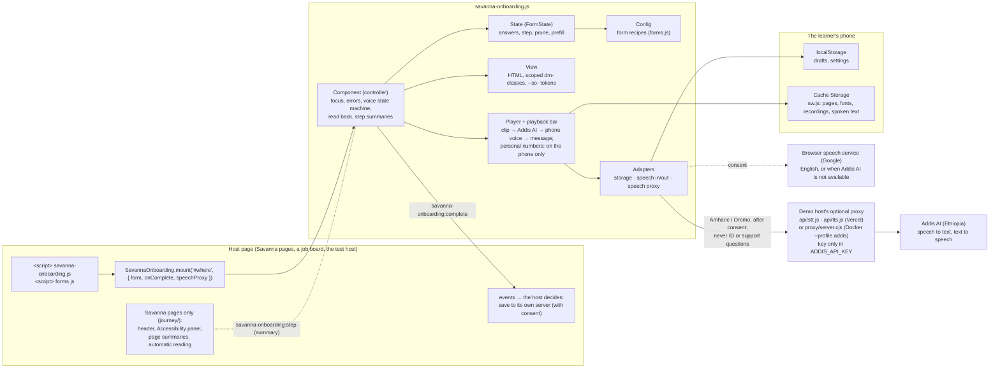

# Architecture (one page)

A **framework-free web component** that any page adds with two script tags. No build step, no database, no paid
API required. **The module never needs a server**; the host decides where data goes. Our demo host adds one optional
server part: a reference proxy for Addis AI speech (Amharic and Afaan Oromo).

| Part | File | Job |
|---|---|---|
| Config | `forms.js` | Seven journeys as plain data: sign-up (no ID question), Add your ID (optional), profile, takeover, Support Passport, job application, employer form. Flags: `sensitive` (no voice; numbers read on the phone only), `clearIfChanged`, `prefill`, `badge`, `askHelper`; hand-written question topics for the summaries |
| State | `FormState` in `savanna-onboarding.js` | Answers and position; deletes answers from abandoned routes; asks newly opened questions after "Change"; saves the draft after every question; deletes it on submit |
| View | `View` | One question per screen, the question as the heading, error summary, check your answers (with "Read all my answers"), Listen buttons, read-back buttons. Ids prefixed per form, so several forms can share a page |
| Controller | `SavannaOnboardingForm` (custom element) | Focus, keyboard, errors, help (with Listen), voice state machine (consent → recording → "I heard…" read back → use), step summaries in three languages (`step` event), offline message |
| Player | `Player`, `PlayBar` | One player for everything: recorded clip (`assets/audio/manifest.json`: 861 clips, every fixed text in Amharic and Afaan Oromo, incl. numbers 0-99 and month names) → Addis AI through the proxy (Amharic, Oromo) → the phone's voice → one plain message. Each piece in its own language. `local` pieces (phone and ID numbers, a date of birth) never use an online voice. "Now reading… Pause · Stop" pinned to the bottom only while audio plays; Escape stops |
| Adapters | `setStorage()`, `setSpeech()`, `setSpeechProxy()` / `mount({ speechProxy })` | Replace device storage or speech; send Amharic and Oromo speech to the host's own proxy. The module holds no key and no third-party address |
| Reference proxy | `api/_addis.js` (+ `api/stt.js`, `api/tts.js`, `../proxy/server.cjs`) | Demo host only. Uses Addis AI's documented endpoints; 30-second / 2 MB recordings, 600 characters, per-IP rate limit, own origin only, TTS cache; falls back cleanly without a key or credit |
| Savanna pages | `index.html` … and `journey/` | One header bar (Home; Language ▾, Accessibility ▾, Log in / account; Menu on phones); page summaries (three languages) first in `<main>`; automatic reading when a page or step opens; the first-visit prompt |
| Host API | `mount()`, `unmount()`, events (`complete`, `step`, `prefs`, `audioblocked`), `describe()`, `itemsFromElement()`, `supportForEmployer()`, `trustLevel()` | Level 1 integration; data contract in `api-schema.md` |
| Standards | JobPosting JSON-LD (job board) | Level 3 integration |
| Offline | `sw.js` | Pages, module, fonts and styles after one visit; recordings when played or downloaded; spoken text kept in the browser |
| Demo hosts | Savanna pages, `showroom.html` + `app.js`, `test-host/` | The realistic journey; the developer page (JSON views); a plain host using only the public API |
| Savanna styles | `vendor/savanna-static-pages/` | ALX's stylesheets, fonts and images, unchanged (not under our licence) |

**Principles:** access without disclosure (learners choose *how*, never say *why*); show trust, do not claim it;
nothing leaves the host without consent; one engine, many journeys; honest labels (never "verified", simulated parts
say so).
