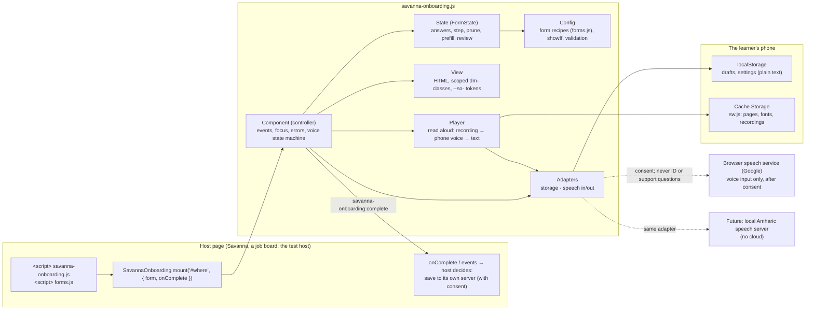

# Architecture (one page)

A **framework-free web component** that any page adds with two script tags. No build step, no server, no database,
no paid API. The host page decides where data goes.

| Part | File | Job |
|---|---|---|
| Config | `forms.js` | Six journeys as plain data: sign-up, profile, takeover, Support Passport, job application, employer form. Flags: `sensitive` (no voice), `clearIfChanged`, `prefill`, `default`, `badge`, `askHelper` |
| State | `FormState` in `savanna-onboarding.js` | Answers and position; deletes answers from abandoned routes; asks newly opened questions after "Change"; saves the draft after every question; deletes it on submit |
| View | `View` | Turns the state into HTML: one question per screen, the question as the heading, error summary, check your answers. All ids prefixed per form, so several forms can share a page |
| Controller | `SavannaOnboardingForm` (custom element) | Focus, keyboard, errors, language switch, help, voice state machine (consent → listening → check → use), offline message |
| Player | `Player` | Read aloud: recorded clip (by name, via `assets/audio/manifest.json`) → phone voice → "words are on the screen"; pause, stop, replay |
| Adapters | `setStorage()`, `setSpeech()` | Replace device storage, speech input or speech output (e.g. a local Amharic model) without touching the forms |
| Host API | `mount()`, `unmount()`, events, `supportForEmployer()`, `trustLevel()` | Level 1 integration; data contract in `api-schema.md` |
| Standards | JobPosting JSON-LD (job board) | Level 3 integration |
| Offline | `sw.js` (sample service worker) | Pages, module, fonts and styles kept after one visit; recordings when played or downloaded |
| Demo hosts | `index.html` … (Savanna pages, `journey/`), `showroom.html` + `app.js`, `test-host/` | The realistic journey inside Savanna's starter pages; the developer page; a plain host using only the public API |
| Savanna styles | `vendor/savanna-static-pages/` | ALX's stylesheets, fonts and images, unchanged (not under our licence) |

**Principles:** access without disclosure (learners choose *how*, never say *why*); nothing leaves the host without
consent; one engine, many journeys; honest labels (never "verified", simulated parts say so).
